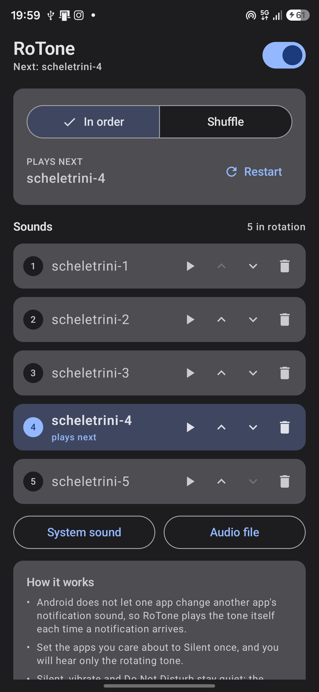
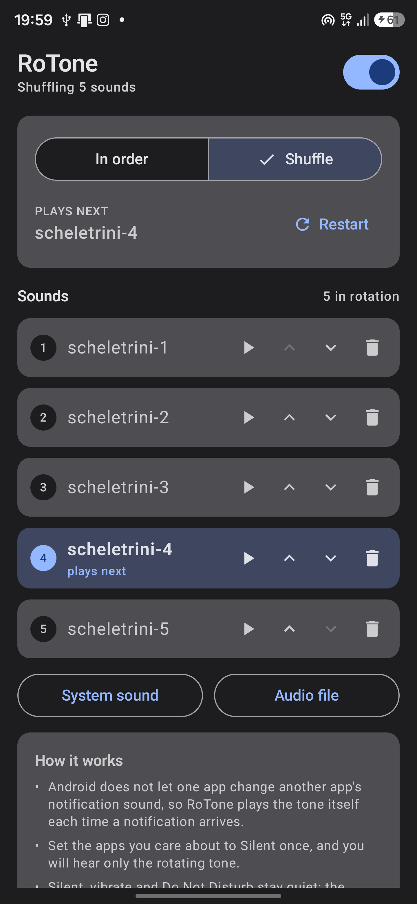

# RoTone

[](https://github.com/cazzevongole/rotone/actions/workflows/ci.yml)
[](https://github.com/cazzevongole/rotone/releases/latest)

**RoTone rotates the sound your phone plays for notifications.**

Put any number of notification ringtones — or your own audio files — into a list, arrange them in
the order you want (or switch to shuffle), and every time a notification plays RoTone sounds the
next tone and moves the pointer on, looping back to the first at the end. No more hearing the same
blip for the whole day.

| | |
| --- | --- |
| Package | `cazzevongole.rotone` |
| Platform | Android 8.0 (API 26) and newer |
| Built with | Kotlin, Jetpack Compose (Material 3) |
| Permissions | Notification access only — no network, no accounts, no analytics |
| Size | ~9.5 MB debug APK |

## Screenshots

| In order | Shuffle |
| --- | --- |
|  |  |

---

## The one thing to know before using it

Android does not let one app change another app's notification sound. There is no API for it, and
apps that try are fighting the system. RoTone works with the platform instead:

1. You grant it **notification access**, so it can see when a notification is posted.
2. When one arrives, RoTone plays the next tone in your rotation itself, on the notification audio
   stream (so the notification volume and silent mode apply).
3. To hear only RoTone, set the apps you care about to **Silent** once, in their own notification
   settings — otherwise their normal sound plays on top of the rotating tone.

That third step is the only manual setup, and it is a one-time job per app.

## What the app looks like

A single screen, top to bottom:

- **Header** — the app name, a one-line status (`Next: <tone>`, `Shuffling 4 sounds`, or `Paused`)
  and the on/off switch that pauses the rotation without losing your list.
- **Access card** — only while notification access is missing; it explains the permission and opens
  the right system screen.
- **Rotation card** — a two-option selector (*In order* / *Shuffle*), a **PLAYS NEXT** line naming the
  tone that will sound next, and a **Restart** button that puts the pointer back at the top.
- **Sounds list** — numbered rows in play order, the upcoming row highlighted, with a preview,
  move up, move down and remove button on each row.
- **Add buttons** — *System sound* (the Android ringtone picker) and *Audio file* (any audio file on
  the device).
- **How it works card** — the short version of the notes above.

Dark and light themes follow the system, with Material You dynamic colours on Android 12+.

## Install it on a phone

### Option A — download the released APK (easiest)

Every green push to `main` publishes the APK to the
[Releases](https://github.com/cazzevongole/rotone/releases/latest) page, so this link always points
at the newest build:

1. Open the latest release and download **`app-debug.apk`**.
2. Open it on the phone and allow "install unknown apps" for the app you opened it from when Android
   asks.

The release is rebuilt from `main` on each push, and the release notes record the commit it came
from.

### Option B — install over USB with adb

With the phone connected and USB debugging enabled:

```bash
adb install -r app-debug.apk
adb shell am start -n cazzevongole.rotone/.MainActivity
```

Any build from the [Actions](https://github.com/cazzevongole/rotone/actions) tab works here too: the
**rotone-debug-apk** artifact of a run is the same file that gets released.

### Then grant notification access

Open RoTone and tap **Open access settings**, find **RoTone** in the list and turn it on. The system
path is *Settings → Notifications → Advanced → Notification access*.

From a computer you can also do it with:

```bash
adb shell cmd notification allow_listener \
  cazzevongole.rotone/cazzevongole.rotone.service.RotationListener
```

## Using it

1. **Add sounds** — *System sound* to pick a built-in ringtone/notification tone, *Audio file* to
   import anything from storage. Each one is copied into the app, so it keeps working if the original
   is deleted or the SD card is removed.
2. **Arrange them** — the up and down arrows next to each row. The order is the playback order.
3. **Choose a mode** — *In order* for a fixed cycle, *Shuffle* for a random tone each time (it will
   not repeat the tone that just played). Both loop forever.
4. **Silence the apps you want RoTone to cover** — in each app's notification settings, or in
   Android's, set the channel to Silent.
5. Send yourself a notification and watch the highlighted row move down the list.

Silent and vibrate modes, and Do Not Disturb, are respected: when they are on, no tone plays and the
pointer does not move.

## Build it yourself

### Requirements

- **JDK 17** (Android Studio's bundled JDK works).
- **Android SDK** with platform 35 and build-tools 35 (Android Studio installs these).
- The Gradle wrapper is committed, so you do not need Gradle installed: it downloads Gradle 8.9.

Gradle / AGP / Kotlin versions are pinned in `gradle/wrapper/gradle-wrapper.properties` and
`build.gradle.kts` (Gradle 8.9, AGP 8.7.3, Kotlin 2.0.21).

### Command line

```bash
git clone https://github.com/cazzevongole/rotone.git
cd rotone

# Point the build at your SDK (Android Studio writes this file for you automatically)
echo "sdk.dir=$HOME/Android/Sdk" > local.properties

./gradlew testDebugUnitTest   # unit tests
./gradlew assembleDebug       # app/build/outputs/apk/debug/app-debug.apk
adb install -r app/build/outputs/apk/debug/app-debug.apk
```

`local.properties` is git-ignored on purpose: the SDK path is machine-specific. On Windows the path
needs escaped backslashes, e.g. `sdk.dir=C\:\\Users\\you\\AppData\\Local\\Android\\Sdk`.

### Android Studio

1. *File → Open* and select the repository folder.
2. Let the Gradle sync finish (it will create `local.properties`).
3. Pick the `app` run configuration and press Run.

### Release build

```bash
./gradlew assembleRelease
```

R8 code shrinking and resource shrinking are enabled, so the result in
`app/build/outputs/apk/release/app-release-unsigned.apk` is unsigned. Sign it with your own keystore
via `apksigner` (or add a `signingConfig`) before installing it. The released APK on the Releases
page is the signed-by-debug-key CI build, which installs directly but cannot be uploaded through the
Play Store.

## Tests

```bash
./gradlew testDebugUnitTest
```

JVM unit tests, no device or emulator needed:

| Test class | Covers |
| --- | --- |
| `RotationTest` | In-order walking and wrapping, stale pointers, advance/loop, empty rotation, shuffle range and no-repeat behaviour, single-sound rotation |
| `RotationJsonTest` | Persistence round trip, missing and corrupt JSON, pointer wrapping, negative pointers, entries without an audio file, unknown mode, default `enabled` |
| `RotationStateTest` | `nextTone` on an empty list (regression test for the first-launch crash) and pointer wrapping |

HTML reports: `app/build/reports/tests/testDebugUnitTest/index.html`.

The Android-dependent pieces (notification listener, `MediaPlayer`, file import) are intentionally
thin wrappers around the pure logic in `Rotation.kt` and `RotationJson.kt`, which is what the tests
exercise.

## CI

`.github/workflows/ci.yml` runs on every push to `main` (and on manual dispatch), as three separate
jobs:

| Job | What it does | Runs after |
| --- | --- | --- |
| **Unit tests** | `./gradlew testDebugUnitTest`, uploads the HTML report | — |
| **Build debug APK** | `./gradlew assembleDebug`, uploads `rotone-debug-apk` | tests pass |
| **Publish APK to Releases** | downloads the APK and attaches it to the `v<versionName>` release, creating it on the first run and updating it afterwards | build passes |

A failing test therefore stops the build before it starts, and a failing build means no release is
published. The release job has a write-scoped `GITHUB_TOKEN`; the other two are read-only. Because
the tag is derived from `versionName` (`1.0` today), pushes to `main` update the same release until
the version in `app/build.gradle.kts` changes.

## How it works

```
RotationListener (NotificationListenerService)
        │  filters, then asks Rotation for the next index
        ▼
Rotation.pick()  ── in order: pointer, wrapped; shuffle: random, never the last tone
        ▼
TonePlayer (MediaPlayer, USAGE_NOTIFICATION)  →  speaker
        ▼
ToneStore (SharedPreferences JSON + files in filesDir/tones)  →  nextIndex, lastPlayedIndex
```

**Notification filters** — the listener ignores its own notifications (so previews do not advance
the rotation), group summaries, ongoing and foreground-service notifications, local-only ones, and
repeat updates of the same notification within 2 seconds. A second notification within 800 ms of a
tone, or one that arrives while a tone is still playing, is ignored rather than overlapping.

**Rotation state** — `enabled`, `mode` (`order`/`shuffle`), `nextIndex` (the pointer shown as
*plays next*), `lastPlayedIndex` (used by shuffle to avoid a repeat) and the ordered `tones` list with
`id`, `name` and `fileName`. The pointer only advances when a tone actually starts playing, so a
corrupt file does not silently skip a slot.

**DND** — `AudioManager.ringerMode` must be `RINGER_MODE_NORMAL` and the interruption filter must be
`INTERRUPTION_FILTER_ALL`, otherwise the tone is skipped and the pointer stays put.

## Project layout

```
app/src/main/java/cazzevongole/rotone/
├── MainActivity.kt               composition root: state, pickers, persistence glue
├── audio/TonePlayer.kt           MediaPlayer wrapper on the notification stream
├── data/
│   ├── ToneStore.kt              Tone / PlayMode / RotationState models + files and SharedPreferences
│   ├── Rotation.kt               pure play-order logic (tested)
│   └── RotationJson.kt           pure persistence format (tested)
├── service/RotationListener.kt   NotificationListenerService that advances the rotation
└── ui/
    ├── RotationScreen.kt         the whole screen in Compose
    └── Theme.kt                  Material 3 theme, dynamic colours
app/src/test/java/cazzevongole/rotone/data/   JVM unit tests
docs/                                         screenshots used above
.github/workflows/ci.yml                      tests, build, release
```

## Troubleshooting

- **Nothing is heard.** Check, in order: notification access is on for RoTone; the phone is not in
  silent, vibrate or Do Not Disturb mode; the list is not empty and the switch is on; the imported
  file really is audio.
- **Two sounds play at once.** The app that posted the notification still has its own sound. Set
  that channel to Silent.
- **The pointer never moves.** It only advances when a tone starts. A file the decoder cannot read
  leaves it in place — preview the row to confirm the tone works.
- **Rotation stops after a while.** Some vendors (Samsung, Xiaomi, Huawei) aggressively kill
  background apps; exclude RoTone from battery optimisation if the listener stops receiving
  notifications.
- **Play Store-style warnings on install.** The released APK is built by CI with the debug key and
  is not from a store; sideloading always shows the "unknown app" prompt.

## Not included

- The rotation is **global**: one list, one pointer, every notification that reaches the listener.
  Per-app rotation is not implemented — the notification's originating package would have to be
  matched against per-app lists, which the listener already receives as `sbn.packageName`.
- The app does not modify other apps' sounds, does not post its own notifications, has no network
  permission, and stores nothing outside its own private folder.
